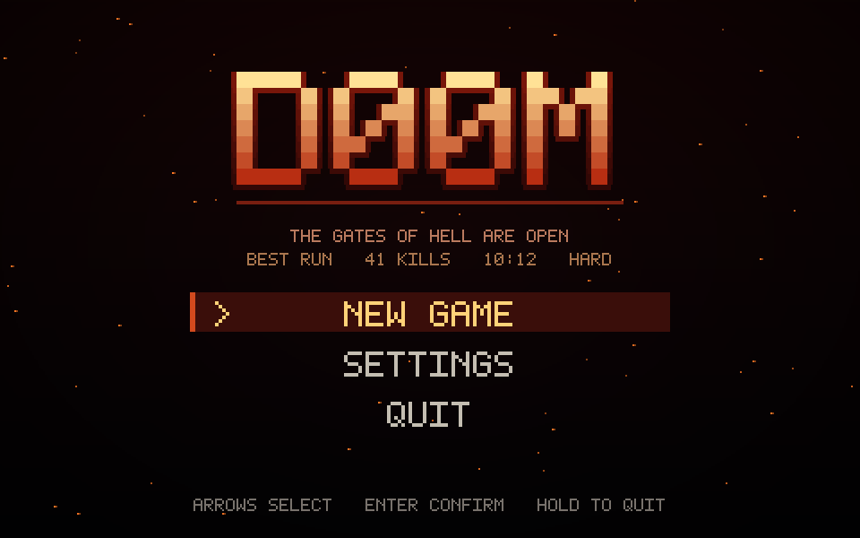
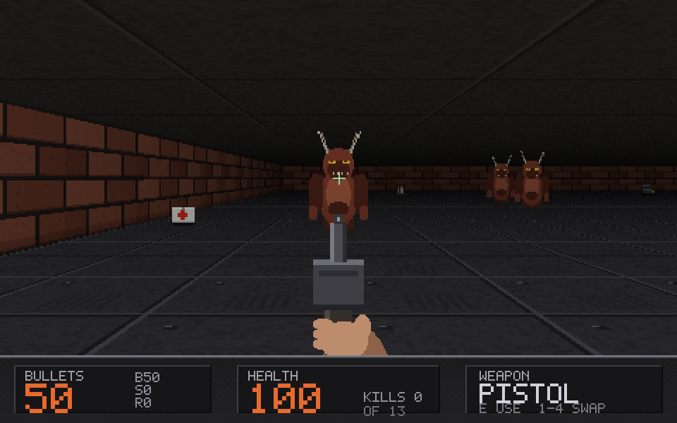
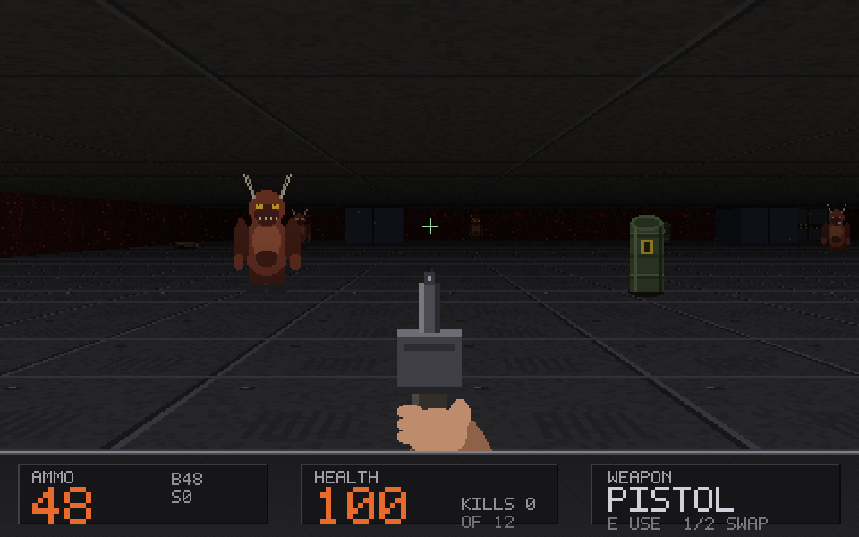
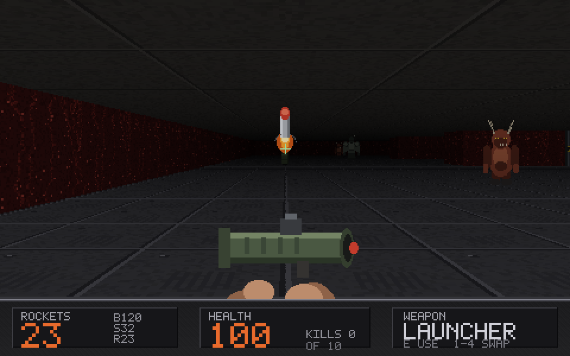
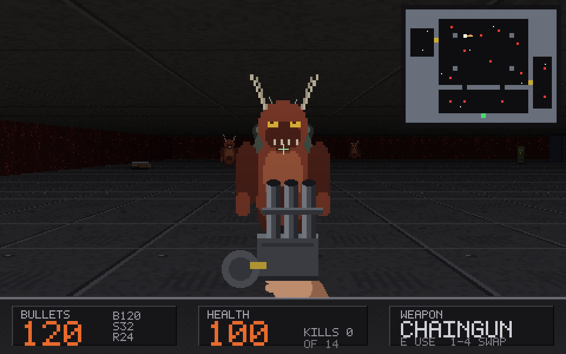
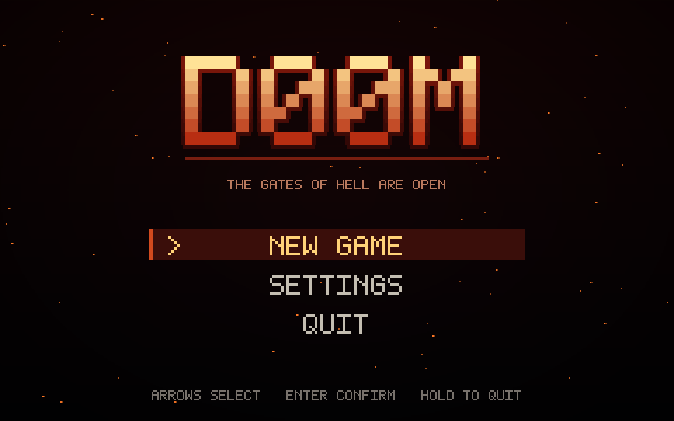
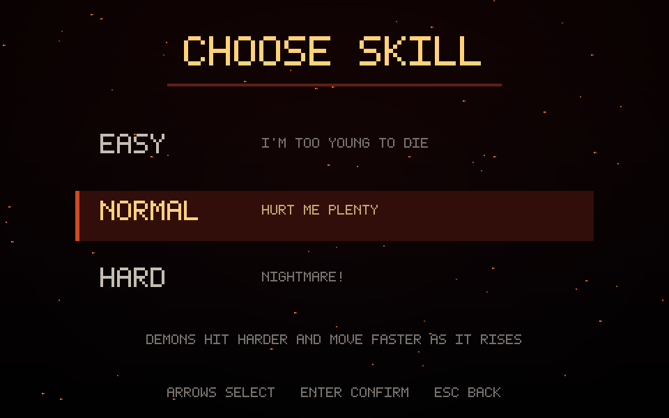

<p align="center">
  
</p>

<h1 align="center">D00M</h1>

<p align="center">
  <strong>A Doom-style FPS written from scratch in Rust.</strong><br>
  No engine. No asset files. Every texture, sprite, weapon and sound is generated procedurally at start-up.
</p>

<p align="center">
  
  
  
  
  
  
</p>

<p align="center">
  
  
</p>
<p align="center">
  
  
</p>

---

## What is this?

D00M is a complete five-level FPS episode built on a hand-written software
raycaster — the renderer, game logic, art and audio are all original Rust
code in this repo. It started as an experiment ("how much Doom can you rebuild
with no engine and no assets?") and turned into a full game: textured walls,
floors and ceilings, sliding doors, secret niches, enemy AI, explosive
barrels, four weapons, three monster types and a boss, three difficulties, a
full menu front end, save slots, gamepad support and a fully synthesised
soundtrack — effects, ambience and score alike.

Everything you see and hear is computed when the game starts:

- **7 wall textures, 39 sprites, 8 weapon frames** — painted in code, pixel by pixel
- **28 sound effects, an ambient bed and a 16-bar score in D minor** — synthesised waveforms, no samples
- **A 5×7 bitmap font** — drawn by hand, stored as code
- **5 levels** — drawn as ASCII maps, each hiding one secret

The only dependencies are the platform plumbing: `winit` (window),
`softbuffer` (framebuffer), `cpal` (audio) and `gilrs` (gamepads).

## Play it

Grab the Linux binary from the
[latest release](https://github.com/ItCompiledShipIt/D00M/releases/latest),
unpack it and run `./d00m` — no toolchain needed. Or build from source:

```sh
git clone https://github.com/ItCompiledShipIt/D00M.git
cd D00M
cargo run --release
```

You need Rust (installed with [rustup](https://rustup.rs/)). Developed and
tested on Linux. Clear each level by killing your way to the green **EXIT**
switch and pressing `E` on it. Beat all five levels to reach the
episode-complete screen and, if the run is good enough, the high-score table.

## The episode

| Level | Name | What to expect |
| --- | --- | --- |
| E1M1 | Entryway | Learn the pistol, find the shotgun, first imps |
| E1M2 | The Foundry | Tech halls, crates, more teeth |
| E1M3 | Gates of Hell | The episode turns red and means it |
| E1M4 | Crimson Depths | Tight rooms, crossfire, barrel traps |
| E1M5 | The Inferno | Everything, everywhere — and the Gatekeeper holds the exit |

## Difficulty

Pick your skill on the way in. Difficulty scales the demons, not just the
numbers on the box:

| | I'm Too Young to Die (Easy) | Hurt Me Plenty (Normal) | Nightmare! (Hard) |
| --- | --- | --- | --- |
| Damage taken | 0.55× | 1.0× | 1.5× |
| Imp health | 30 | 40 | 56 |
| Imp speed | 0.8× | 1.0× | 1.25× |
| Imp attack cooldown | 1.35× slower | 1.0× | 0.72× — faster |
| Demons spawned | a third fewer | all | all |
| Supplies spawned | all | all | a third fewer |
| Pickup strength | 1.25× | 1.0× | 0.8× |

## Controls

### Keyboard and mouse

| Key | Action |
| --- | --- |
| `W` `A` `S` `D` | Move and strafe |
| Mouse / `←` `→` | Turn |
| `Shift` | Run |
| Left mouse / `Space` / `Ctrl` | Fire |
| `E` | Open a door / use the exit switch |
| `1` `2` `3` `4` | Pistol / shotgun / chaingun / rocket launcher |
| `[` `]` | Cycle through the guns you own |
| `Tab` | Automap |
| `R` | Restart level |
| `Esc` | Pause / back |

Menus: `↑` `↓` (or `W` `S`) to select, `Enter` to confirm, `←` `→` to change a
value. Quitting from the title screen takes a held key — pick `QUIT` and hold
`Enter` (or hold `Esc`) until the bar fills. It's saved more runs than any
autosave.

### Gamepad

Left stick or D-pad moves, right stick turns, right trigger fires, `X`/`Y`
uses doors and switches, `LB`/`RB` cycle weapons, `Select` opens the automap,
`Start` pauses, `B` backs out of menus. Menus take the D-pad and `A` to
confirm. No controller? The game doesn't care. Plug one in mid-game and a
note appears; unplug it and the game carries on.

## Front end

<p align="center">
  
  
</p>

- **Title screen** with an animated ember backdrop and your best run so far
- **Skill selection** before every new game, and an **intro crawl** that
  skips with `Enter`
- **Settings** — mouse and stick sensitivity, inverted stick, fullscreen —
  plus a **volume menu** with master, effects and ambient sliders. Both are
  written to disk as you change them and restored next run
- **Save slots** — a run autosaves at every level start and whenever you
  pause or quit, into one of three slots. `CONTINUE` picks up the most
  recent save; `LOAD GAME` lists all three with their level, kills, time and
  skill; `SAVE GAME` in the pause menu writes the run to a slot you choose
- **Intermissions** between levels with kills, secrets found and time, and an
  **episode-complete screen** with a top-five high-score table (kills, time,
  skill) that persists between runs

## Under the hood

- **Renderer** — textured DDA raycaster at a 480×300 internal framebuffer,
  upscaled to the window: distance fog, side shading, per-row textured floors
  and ceilings, head bob and view kick. Billboard sprites are depth-tested
  per column against the wall z-buffer and sorted back to front, so demons,
  barrels, pickups and projectiles occlude correctly.
- **Doors** — sliding doors block sight, sound and movement until opened, and
  auto-close behind you. Every level also hides a **secret niche** in its
  walls — dressed in the neighbouring wall texture, invisible on the
  automap — that slides open once, stays open, and holds a medkit.
- **Enemies** — four kinds sharing one idle/chase/attack/pain/death state
  machine: imps (fireballs), demons (fast, melee-only chargers), hell
  knights (slow, heavily armoured — their plates turn aside a quarter of
  every hit — and throw green hellfire) and **the Gatekeeper**, a 600-HP
  boss who fans hellfire in threes, enrages at half health, and seals the
  final exit for as long as he lives. Each kind has its own health, speed,
  reach, damage and cooldown, its own synthesised voice (sight, pain,
  attack and death), and corpses stay where they fell.
- **Weapons** — pistol, shotgun (seven pellets), chaingun (rapid single
  bullets) and rocket launcher (travelling rockets with splash damage that
  also chain-detonate barrels and hurt you at close range). Every blast
  leaves a three-frame flash, fireball and smoke puff that grows and fades.
- **Armour** — one vest per level. While you wear it, it eats a third of
  every hit until it is spent; the HUD shows what is left.
- **Audio** — every effect is a synthesised waveform pre-rendered into a
  sample bank at start-up, then mixed live over `cpal`: stereo pan and
  distance falloff per voice, a hard voice cap, ambient ducking in menus, and
  a graceful fall-back to silence when no audio device exists. The score is
  composed the same way — a 16-bar loop in D minor (eighth-note bass, minor
  pads, a bell lead, a kit of sine drops and noise) that crossfades in for
  gameplay and out again in the menus.
- **Saves** — a versioned line-per-entity text format (`D00M SAVE 1`):
  diffable, hand-editable, and decoded defensively — a corrupt save is simply
  not offered, never half-loaded.
- **Settings and scores** live at `$XDG_CONFIG_HOME/d00m/` (else
  `~/.config/d00m/`): `config.txt`, `save1.txt`–`save3.txt`, `scores.txt`.

### Layout

| File | Contents |
| --- | --- |
| `src/main.rs` | Window, event loop, screen state machine, input mapping, CLI |
| `src/ui.rs` | Title, intro, settings, volume, pause and intermission screens |
| `src/levels.rs` | The five ASCII maps and their names |
| `src/game.rs` | Player, weapons, enemy AI, pickups, explosions, difficulty |
| `src/map.rs` | ASCII level, doors, collision, line of sight |
| `src/render.rs` | Raycaster, floor casting, sprites, HUD, automap |
| `src/textures.rs` | Procedural wall/sprite/weapon art |
| `src/gfx.rs` | Colours and the texture rasteriser primitives |
| `src/font.rs` | 5×7 bitmap font |
| `src/audio.rs` | Synthesised effects, ambient loop, mixer and cpal stream |
| `src/pad.rs` | Gamepad polling and the mapping from buttons to actions |
| `src/config.rs` | Settings, difficulty persistence and the score table |
| `src/save.rs` | Save slots: encoding, decoding and load-screen summaries |
| `src/shot.rs` | Headless BMP capture |
| `src/math.rs` | `Vec2`, RNG, noise |

## Development

```sh
cargo test               # 92 unit tests
cargo clippy --all-targets
cargo run --release -- --shot frame.bmp --at 17.2,2.5,0 --steps 20 --fire
```

The test suite checks invariants, not just functions: every level is
rectangular and fully enclosed, every entity is reachable from spawn, every
exit switch can be used, saves round-trip and reject junk, the mixer enforces
its voice limit, and every front-end screen renders.

`--shot` renders frames headlessly to a BMP — every screenshot on this page
was captured with it:

```sh
cargo run --release -- --shot out.bmp --level 2 --steps 45 --fire
cargo run --release -- --shot out.bmp --level 2 --map
cargo run --release -- --shot out.bmp --screen menu
```

`--at X,Y,ANGLE` places the player, `--level N` selects a map (0–4), `--map`
shows the automap, `--use` presses the use key once, `--fire` holds the
trigger, and `--screen` captures any front-end screen:
`menu|load|save|notice|skills|settings|volume|intro|pause|intermission|episode`.
`--weapon 0-3` equips a gun before the frame is drawn, for checking its art.

## Roadmap

- Vertical mouselook / true 3D sectors
- A proper sprite-sheet animation system
- Rebindable keys
- Mouse look while a gamepad is connected (currently the right stick only)
- Deleting or renaming individual save slots
- Windows and macOS builds

## License

MIT — see [LICENSE](LICENSE).

---

*Built conversationally — specced in plain text, shipped by an AI agent, and
verified on the machine it runs on. It compiled. It shipped.*
